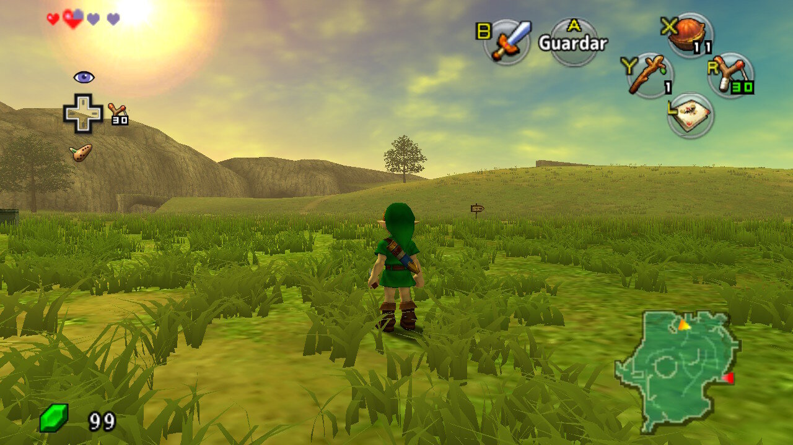
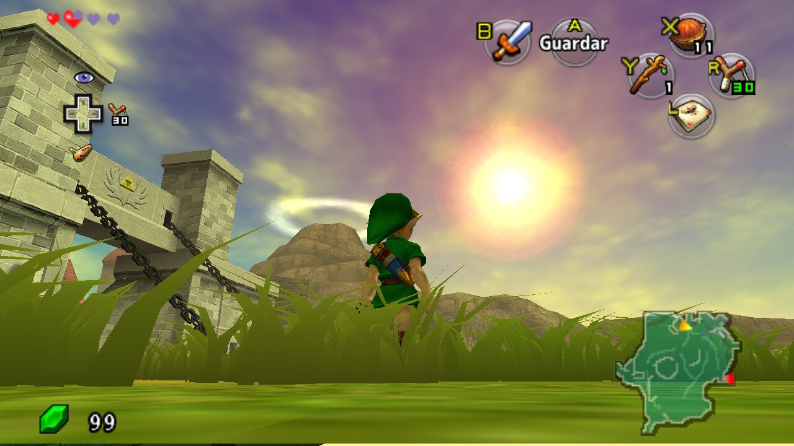
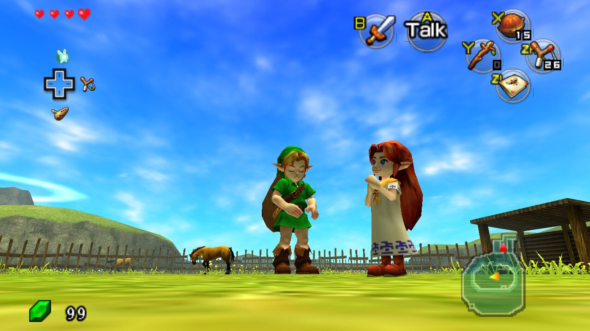
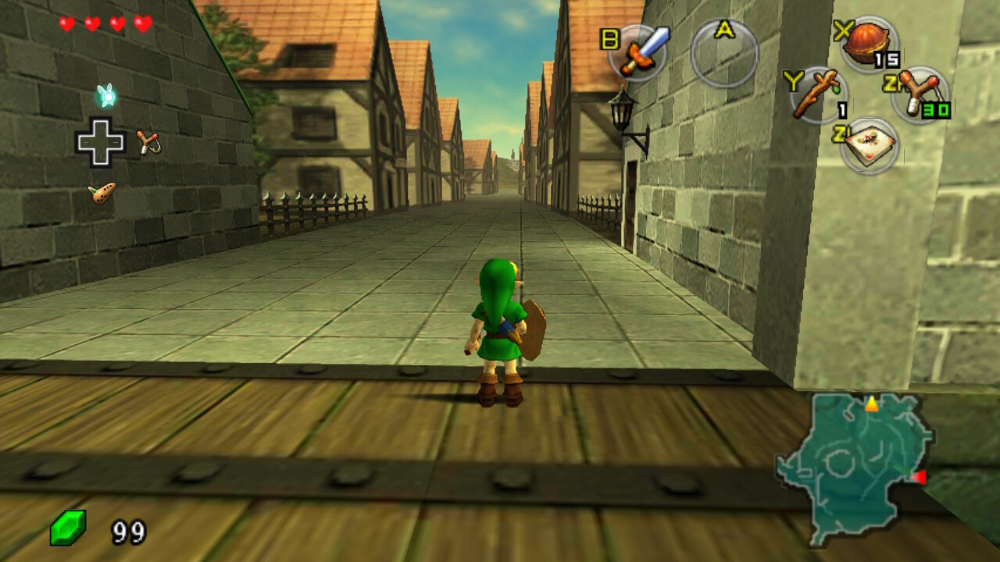

# Ocarina of Time 3D no Nintendo Switch (TriAevum-Switch)

Port para Nintendo Switch (homebrew) do [TriAevum](https://github.com/coccofresco/TriAevum), a recompilação
nativa de *The Legend of Zelda: Ocarina of Time 3D*, por **Gustavo Henrique Rocha**, com renderizador deko3d,
legendas em português do Brasil e uma tela só. Nenhuma ROM acompanha o projeto: o jogo é montado no console a
partir do dump do seu próprio cartucho.



| | |
|---|---|
|  |  |
|  | |

Prints tirados no próprio console (Switch Lite).

## Como instalar

**Você precisa** de um Switch com Atmosphère e de um dump decriptado do seu cartucho de *Ocarina of Time 3D*
(`.3ds` ou `.cci`): USA Rev 1 (En, Fr, Es) ou europeu (original ou Rev 1). O GodMode9 num 3DS desbloqueado faz o
dump. Cópias da eShop (`.cia`) e outras versões não funcionam.

1. Baixe `oot3dre-<versão>-switch.zip` em [Releases](https://github.com/GustavoHenriqueRocha/TriAevum-Switch/releases)
   e extraia na raiz do cartão SD. Ele cria `switch/oot3dre/`.
2. Copie o seu dump para `switch/oot3dre/`.
3. Abra o jogo com a memória de um jogo: segure R ao abrir qualquer jogo e escolha o TriAevum no menu de
   homebrew. O primeiro início transforma o dump nos arquivos do jogo (cerca de um minuto) e pergunta se
   mantém (A) ou apaga (Y) o dump. Um forwarder no menu HOME feito com o [Sphaira](https://github.com/ITotalJustice/sphaira)
   também funciona.
4. **Português:** a tradução ocupa o lugar do espanhol. Aperte os dois analógicos (L3+R3), aba **Language**, e
   escolha **Espanol**.

- **Menu:** L3+R3 abre as configurações, o painel de desempenho e Sair do jogo. O toque funciona no menu.
- **Controles:** mira por giroscópio (console, Pro Controller ou par de Joy-Cons) e ícones de item, X/Y e
  direcional na tela de toque.
- **Padrões:** 60 fps por interpolação (apague `switch/oot3dre/config/fps60` para 30 fps).
- **HUD de tela única:** a arte vem do mod [Single Screen Experience](https://gamebanana.com/mods/695893)
  (rlgcarrot/M-1, CC BY-NC-ND 4.0), que a licença deixa baixar e instalar, mas não redistribuir. No primeiro
  início o console oferece baixá-lo do GameBanana e monta o HUD a partir dos arquivos do seu jogo.
- **Atualizações:** o botão de atualizar do menu ainda não consulta este repositório; baixe a release nova aqui.

## Créditos

- **coccofresco** e os contribuidores do [TriAevum](https://github.com/coccofresco/TriAevum): a recompilação, o
  runtime e o renderizador. Os créditos completos do projeto original estão abaixo e em
  [THIRD_PARTY_NOTICES.md](THIRD_PARTY_NOTICES.md).
- **[John Uzoka](https://github.com/JohnUzoka/TriAevum-Switch)**: importação do dump no console, giroscópio,
  toque, painel de desempenho, atualizador e otimizações do port.
- **SolidOne e LordeJabiraca**: o texto em português do mod PT-BR do Ship of Harkinian, convertido para o 3DS
  neste port.
- **rlgcarrot/M-1**: TopScreen / Single Screen Experience.
- Fontes M PLUS Rounded 1c e Belleza (SIL Open Font License) nos menus em PT-BR.
- **devkitPro / deko3d**, **Azahar**, **Ship of Harkinian** e **libultraship**.
- **Nintendo e Grezzo**, que criaram o jogo. Este projeto não tem relação com a Nintendo.

Notas do port: [SWITCH_PORT.md](SWITCH_PORT.md). Para portar outros jogos de 3DS:
[docs/PORTING_GUIDE_3DS_SWITCH.md](docs/PORTING_GUIDE_3DS_SWITCH.md).

## Extras (instruções em inglês, do fork do John)

### HD textures (optional)

HenrikoMagnifico's texture pack replaces the world, character and HUD textures with sharper ones.

1. Download the **1080p** version of the
   [Ocarina of Time 3D 4K texture pack](https://www.henrikomagnifico.com/zelda-ocarina-of-time-3d-4k)
   (`OOT3D 4K 5.0a (1080p).zip`, 1.9 GB). If Google Drive says the download quota is exceeded, use the
   MediaFire mirror on the same page.
2. Make a copy at the sizes the Switch uses, on a PC: install [Python 3](https://www.python.org/downloads/)
   and Pillow (`pip install pillow`), download
   [`shrink_texture_pack.py`](tools/switch/shrink_texture_pack.py) into the same folder as the zip, and run

   ```
   python shrink_texture_pack.py "OOT3D 4K 5.0a (1080p).zip" textures
   ```

   It writes a `textures` folder of about 350 MB instead of 1.9 GB (world 2x the original, HUD 3x), so
   the Switch also loads it faster. Add `--parts hud,models` for the HUD and characters only (65 MB).
   `--models 3` keeps characters, creatures and Link at 3x (38 MB instead of 21 MB); then set
   "HD texture size" to 3x in the game, or it draws them at 2x.
   Skipping this step works too: copy the contents of the zip's `user/load/textures/0004000000033500/`
   folder instead, and the game reduces each texture as it loads it.
3. Copy the contents of `textures` (the folders and `pack.json`) to `switch/oot3dre/textures/` on the SD
   card, whatever your dump's region.
4. In the game, L3+R3 → Video → **HD textures**. It applies at once and turns off the same way.
   "HD texture size" (default 2x) is the most the world textures are drawn at. Once the game has
   checked your pack (a few seconds after HD textures come on, the first time), the menu offers only
   sizes your pack has: 1x and 2x for the copy from step 2, up to 3x with `--models 3`, all of them for
   the 1080p pack.

Higher resolution costs some GPU time and memory (about 10–50 MB of textures per area at 2x): if a busy
area slows down, compare the same spot with HD textures off, using the performance overlay.

### Mods: Link models and other game files (optional)

Mods made for the 3DS that replace the game's files (Luma's `romfs` folder) work on the Switch
too. Get them yourself from the mod's page; the port includes and downloads none.

1. Make a folder per mod in `switch/oot3dre/mods/` and put the mod's `romfs` folder in it, e.g.
   [Vanilla+ Link remodel](https://gamebanana.com/mods/705890) →
   `switch/oot3dre/mods/vanilla_plus_link/romfs/actor/zelda_link_boy_new.zar` (its `actor` and `misc`
   folders). For Better Link v3, use its romfs-only variant (without `code.ips`), the same way.
2. Start the game. The first start with a new or changed mod takes a moment ("Applying the
   mods..."); `switch/oot3dre/logs/oot3d_native_game.log` lists what was applied, e.g.
   `romfs mods: 26 files from 1 mod (vanilla_plus_link), 0 ignored`.

- Mods apply in folder name order; when two replace the same file, the later folder wins.
- **Turn them off:** L3+R3 → Game → Gameplay → **Mods (RomFS)**. It applies at the next start.
- Texture-only mods (e.g. Art-Accurate Link, PNG files for Citra/Azahar) are texture packs: copy
  them into `switch/oot3dre/textures/` instead (see HD textures above). With the HD pack installed
  too, the first file in name order wins, so the pack's `LINK` folder beats a mod's loose files:
  put the mod in a folder whose name starts with `0`, e.g. `textures/0-art-accurate-link/`.
- **N64 models** (ModLoader64 `.pak`/`.zobj`, e.g. Skilar's TP Link): convert them with
  [Ocarina ReTuned](https://github.com/OTPR26/Ocarina-ReTuned/blob/main/documentation/Player-models.md)
  on a PC (Settings → Mods → PAK Importer, after preparing your dump there). It writes
  `player-models/<id>/converted.zar` in its data folder (`%LOCALAPPDATA%\Ocarina ReTuned` on Windows,
  `~/Library/Application Support/Ocarina ReTuned` on macOS, `~/.local/share/Ocarina ReTuned` on
  Linux; the most recently modified `<id>` folder is your last import). Copy it as
  `switch/oot3dre/mods/<name>/romfs/actor/zelda_link_boy_new.zar` for adult Link or
  `zelda_link_child_new.zar` for child Link.
- **What does not work:** code patches (`code.ips`, `exefs/`: the game's code is compiled ahead of
  time) and mods that add new files the game does not have. They are skipped and the log says why.
- **Save states** made with other mods (or with none) do not load; in-game saves are not affected.
- A mod's new materials may draw a little slower at first: the console cannot compile shaders, so
  missing ones use a slower general shader (they are saved in `logs/deko3d_shaders/` for the next
  shader pack).

# TriAevum — Echoes of Time

A native PC AOT recompilation of *The Legend of Zelda: Ocarina of Time 3D*,
with a modern NRI/Vulkan renderer, single-screen UI and customizable graphics.
*Echoes of Time* is TriAevum's Ocarina of Time 3D project; executables, data
folders and package names keep the TriAevum name.

## Credit Where It Belongs

Before the shaders, settings and excessive grass: **Echoes of Time would not exist in
its current form without [TopScreen](https://gamebanana.com/mods/695893),
developed by rlgcarrot**. Its single-screen experience is reimplemented here for
our runtime, but the vision, care and tremendous work behind it deserve a
special thank-you. Please consider [buying rlgcarrot a coffee](https://ko-fi.com/rlgcarrot)
to support that fantastic work.

Just as essential are **Azahar, Ship of Harkinian, libultraship, NVIDIA NRI**,
and the SDL controller-mapping community. And, of course, **Nintendo and
Grezzo**, who created the original game. [Full credits and licenses](THIRD_PARTY_NOTICES.md).

> **alpha.3 and alpha.3b are BROKEN and withdrawn. Do not use these builds.**
> Downloads have been removed pending further verification. Back up existing
> saves/settings. [Release status and earlier releases](https://github.com/coccofresco/TriAevum/releases).

## About

Echoes of Time is an AOT recomp in the same general spirit as the Xbox 360 recomp
projects. I just ended up spending most of my time on the renderer instead of,
you know, actually playing the game. The goal is to push the visuals further
without completely losing the original look.

**Development of this project is entirely AI-assisted, under human direction.**
That describes the TriAevum-specific work, not the mature donor projects and
libraries it builds on: Azahar, Ship of Harkinian, NRI and others. Aside from
those foundations, you could fairly call this concentrated AI slop.
Apparently, even AI slop can still consume several months of your life.

## Install

Requires Windows or Linux x64, a Vulkan-capable GPU with current drivers, and your own
supported decrypted ROM. Forge accepts `.3ds` and `.cci` and checks the contents,
not just the filename.

It should work with any personal EUR or USA ROM dump, provided it is decrypted
and in `.cci` or `.3ds` format.
See [ROM compatibility details](docs/TRIAEVUM_CONTENT_FAMILY_IMPORT.md).

### Windows

1. Download the **Windows-x64 ZIP**, not GitHub's source-code archive, and
   extract it into a writable folder.
2. Run `TriAevumForge.exe` and select your decrypted ROM.
3. When setup finishes, choose **Launch game**. Afterwards, use `TriAevum.exe`.

### Linux and Steam Deck

The alpha.3/alpha.3b AppImages are withdrawn; the instructions below describe
the intended packaging, not a currently recommended download.

1. Download the **Linux-x86_64.AppImage** and make it executable in your file
   manager, or with `chmod +x TriAevum-*.AppImage`.
2. Open the AppImage and select your decrypted ROM in Forge.
3. Choose **Launch game** when preparation finishes.

On Steam Deck, prepare in Desktop Mode, then add the same AppImage as a non-Steam
game. Use Steam Input's Gamepad layout without Proton. Physical Steam Deck and
Gaming Mode testing have not yet been performed. `--forge` reopens preparation;
`--appimage-extract-and-run` is available on systems without FUSE.

No compiler or SDK is needed. Forge downloads the official TopScreen texture
package during setup; an Internet connection is required unless that package
is [provided locally](docs/TRIAEVUM_TOPSCREEN_INSTALLATION.md). No ROM or original
game assets are included. Forge also prepares the bundled shaders for your GPU
automatically; shaders encountered later are cached while playing.
Back up your saves, settings and prepared data: `data/` beside the Windows
application, or `$XDG_DATA_HOME/TriAevum` (normally `~/.local/share/TriAevum`)
on Linux. Old Flatpak data remains in `~/.var/app/io.github.coccofresco.TriAevum/`
and is not migrated automatically.

## Graphics and controls

- Cel/toon shading and outlines.
- Ambient occlusion, plus optional reflections, shadows and anti-aliasing.
- Real widescreen framing and configurable field of view.
- **60/90 FPS visual interpolation** of the original 30 Hz game state.
  Game logic and gameplay speed remain unchanged; this is not 60/90 Hz physics.
- Azahar-compatible custom textures and texture dumping.
- Reimplemented **TopScreen** single-screen HUD and menus.
- Configurable gameplay free camera, keyboard/mouse and controller inputs.
- Named settings profiles, audio and save states.
- Procedural grass. A lot of grass. Possibly too much grass.

Press **F1** for settings. **F2** temporarily disables the main added graphics
effects, then restores them without losing your configuration. Most of the
presentation is configurable, so if my artistic decisions offend you
personally, you can probably undo them. Effects can be expensive; adjust them
to suit your GPU.

## Converting other 3DS games (experimental, this fork)

`tools/ctr/ctr_convert.py` turns any decrypted 3DS game into native code with the
same runtime, without a per-game function list:

1. extracts the NCCH (`code.bin`, ExHeader, RomFS);
2. discovers the functions in `code.bin` (`discover_functions.py`);
3. generates the whole-AOT C++ (256 shards);
4. builds and runs the boot probe, or the windowed game with `--window`.

Everything that differs between games lives in one title profile
(`ctr_title_profile.h`). OoT3D keeps its own behaviour; any other title gets the
generic profile, with the OoT3D-only PC features switched off.

Requirements: Linux x64, CMake, Ninja, a Vulkan GPU, and Python 3 with
`capstone==5.0.7` (a venv is fine). Bring your own decrypted `.3ds`/`.cci`: no
game data, generated code or binaries are ever published here.

```sh
python3 tools/ctr/ctr_convert.py "/path/to/Game.3ds" --work ~/conv/game --jobs 2 --run
python3 tools/ctr/ctr_convert.py "/path/to/Game.3ds" --work ~/conv/game --window --run
```

- `--run` writes `<work>/build/title/report.json`. Its stderr lists the services
  and SVCs the game asked for that the HLE does not have yet.
- `--window` builds `oot3d_native_game` in the same tree and saves screenshots
  of the presented frame.
- The first build compiles the 256 shards at `-O0`, which takes a while.
- `tools/ctr/build_title_window.sh` rebuilds the window with other flags, for
  example `OPT="-O2 -DNDEBUG"`.

Status:

| title | where | result |
|---|---|---|
| Super Mario 3D Land | Linux | World 1 map and 1-1 playable: full render, sound, savestates. Full speed (30 fps) in 1-1 on an Intel UHD 620. |
| Ocarina of Time 3D | Linux, Switch | Boots the same with discovered functions as with the hand-reviewed list. On the Switch it costs about 4% more CPU per frame. |

In the window, the bottom screen is shown as a picture-in-picture. A mouse
click on it is a touch, and F7 hides or shows it. Other games will probably hit
services that are not implemented yet; the probe tells you which. Building a
Switch NRO is only wired up for OoT3D. Notes, traps and measurements:
[the port guide](docs/GUIA_PORT_3DS_SWITCH.md) (§8, in Portuguese) and `docs/pesquisas/`.

## Testing and contributing

This is an **experimental alpha**, not a fully tested port. Gameplay testing
currently covers the early parts of the game. The USA adapter has been checked
through installation, the title intro and file selection, not a full playthrough.
I find tweaking shaders considerably more entertaining than finishing Zelda
again, so people willing to actually play through it are especially welcome.

Please [report issues](https://github.com/coccofresco/TriAevum/issues) with the
version, ROM input/revision, GPU/driver, settings and steps to reproduce.
**Normal in-game save files are particularly useful for problems later in the
game.** Review logs for personal information before sharing; do not upload
ROMs, extracted assets or memory savestates containing game code.

Contributions, experiments and forks taking the renderer in other directions
are welcome. [Community contributors and PR credits](docs/TRIAEVUM_CONTRIBUTIONS.md)
are recorded separately from the original AI-assisted development. Longer term,
I would like to explore a proper ray-tracing path
and finish features still in the traditional state known as "technically
implemented". Ray tracing is a wishlist item, not a feature of this release.

[Release notes and known limitations](docs/releases/v0.6.0-alpha.2b.md).

## Screenshots\n\nPrints do Switch no topo desta página.\n\n## Source and license

Original contributions are licensed under **GPL-3.0-or-later**. Third-party
components retain their own licenses and notices:
[license scope](LICENSE_SCOPE.md) and [third-party notices](THIRD_PARTY_NOTICES.md).
See the [release and build contract](docs/TRIAEVUM_PRECOMPILED_RELEASE.md) for
source availability and developer packaging, and the [source map](docs/TRIAEVUM_SOURCE_MAP.md)
for where the main components live.

TriAevum is independent and is not affiliated with or endorsed by Nintendo.

Worst case scenario, at least we got more grass.
